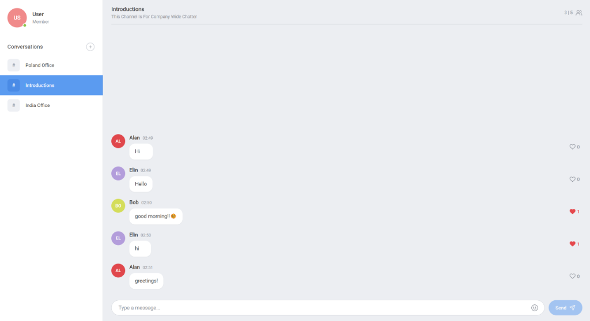
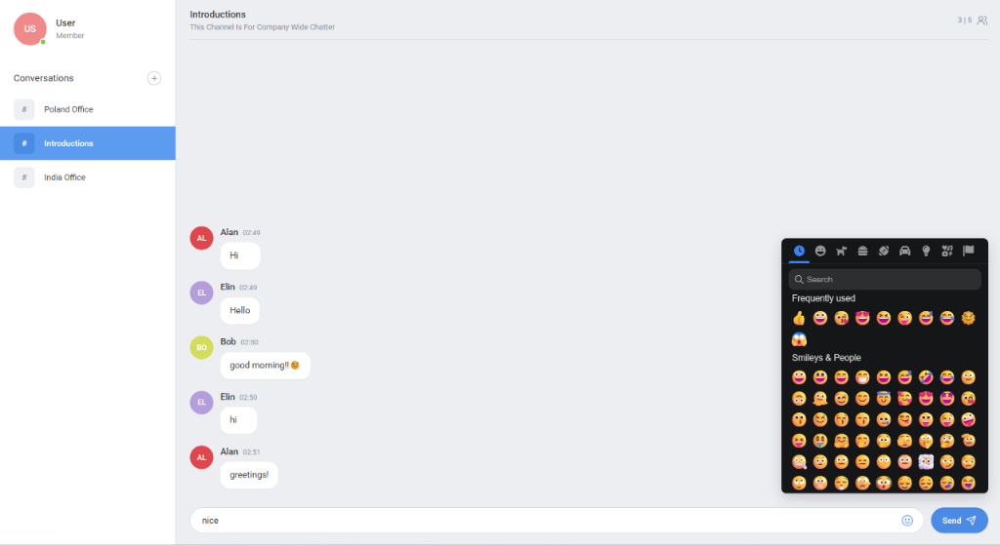

# Full-Stack Real-Time Chat Application

A production-grade, single-page React chat application built to rigorous full-stack standards for a UI Engineering evaluation.

Engineered with strict Test-Driven Development (TDD), zero external UI framework dependencies (pure CSS with design tokens), end-to-end payload validation using Zod, production-hardened web security (anti-XSS, rate limiting, prototype-pollution defenses), and bidirectional real-time synchronization powered by Express and Socket.io.

---

## Visual Demonstration

| Chat Application Main Interface | Integrated Emoji Picker Popover |
| :---: | :---: |
|  |  |
| *Desktop sidebar with profile card, conversation channels, chronological message feed, and inline likes* | *Accessible emoji picker popover with caret insertion and dark theme styling* |

---

## Architectural Highlights & Feature Matrix

### 1. Brief Baseline Requirements [CORE]
- **Single-Page Application (SPA)**: Pure React architecture with zero router (`react-router`) dependencies.
- **Message Positioning**: Sent messages display in a chronological thread **strictly above the input textbox**.
- **Random Author Assignment**: For every sent message, the author is selected at random from the five fixed users:
  ```javascript
  export const user_list = ["Alan", "Bob", "Carol", "Dean", "Elin"];
  ```
- **Like Counter with Instant Feedback**: Like button placed at the right-hand boundary of every message bubble, featuring a micro-animated `like-pop` bounce effect (`+1` per click) and real-time synchronization.

### 2. Desktop & Responsive Experience [SIDEBAR]
- **Pixel-Accurate Sidebar**: 300px fixed layout on desktop featuring a display-only profile card (`User`, `Member`, `US` avatar) with active status indicator.
- **Dynamic Conversations**: Pre-seeded channels (`Poland Office`, `Introductions`, `India Office`) with active channel highlight, isolated state per channel, unread tracking, and inline `+` channel creation.
- **Chat Header**: Displays channel name, topic description, and real-time online presence counter (`${onlineCount} | 5`).
- **Responsive Drawer (<900px)**: Collapses cleanly into a mobile drawer with hamburger toggle button, backdrop dismiss, `Escape` key capture, and accessible focus restoration.

### 3. Extended Product Capabilities [CORE+]
- **Emoji Picker**: Lazy-loaded `@emoji-mart/react` with custom dark-theme styling, accessible popover dialog, outside-click detection, and caret-accurate insertion into the textbox.
- **Smart @mentions Autocomplete**: Typing `@` opens an inline, keyboard-navigable listbox filtering the 5 valid users from `user_list`. Supports Arrow keys (`ArrowUp`, `ArrowDown`), `Enter`, `Tab`, and mouse selection. Rendered in chat bubbles as safe, highlighted `@mention` pills.
- **Offline / Local Fallback**: When the Socket.io server is unreachable or disconnected, the application seamlessly degrades to client-side local mode without throwing unhandled exceptions or disrupting user messaging.

### 4. Production Hardening Audit [SECURITY]
| Requirement | Defense Strategy | Implementation Location |
| :--- | :--- | :--- |
| **F1: Schema Validation** | Zod schemas validate channel names, message length (`1..500`), and socket payloads | `client/src/validation/schemas.js`, `server/schemas.js` |
| **F2: Anti-XSS (Zero HTML Injection)** | Zero usage of `dangerouslySetInnerHTML`. React text node escaping and custom regex tokenization | `client/src/utils/parseMentions.jsx`, `client/src/components/MessageItem/MessageItem.jsx` |
| **F3: Prototype Pollution Protection** | Server-side rooms and messages stored in native `Map` instances rather than object literals | `server/index.js` (`messagesByChannel = new Map()`) |
| **F4: Per-Socket Rate Limiting** | Sliding window rate limits: 5 messages/sec, 10 likes/sec, 3 channels/min | `server/index.js` (`checkRateLimit`) |
| **F5: Bounded In-Memory Storage** | Channels capped at 50, per-channel message history capped at 200 items | `server/index.js`, `server/constants.js` |
| **F6: Secure HTTP & WebSocket Headers** | Helmet with Content-Security-Policy (CSP), Frame Options (`DENY`), XSS Filter | `server/index.js`, `client/vercel.json` |

---

## Real-Time Socket Event Contract

Both client and server adhere to a strict event protocol:

| Direction | Event Name | Payload | Description |
| :--- | :--- | :--- | :--- |
| Client to Server | `channel:join` | `{ channelId: string }` | Joins a channel room and receives room history |
| Server to Client | `channel:joined` | `{ channelId: string }` | Confirms room admission |
| Client to Server | `message:send` | `{ channelId: string, text: string }` | Dispatches new message (server enforces author & ID) |
| Server to Client | `message:new` | `MessageObject` | Broadcasts newly stored message to channel room |
| Client to Server | `message:like` | `{ channelId: string, messageId: string }` | Dispatches like increment request |
| Server to Client | `message:updated`| `{ channelId: string, messageId: string, likes: number }` | Broadcasts updated like count to channel room |
| Client to Server | `channel:create` | `{ name: string }` | Creates a new channel |
| Server to Client | `channel:created` | `ChannelObject` | Confirms channel creation to creator |
| Server to Client | `channels:updated`| `ChannelObject[]` | Broadcasts updated channel list globally |
| Server to Client | `presence:count` | `number` | Real-time count of connected sockets in active room |
| Server to Client | `chat:error` | `{ code: string, message: string }` | Dispatched on validation or rate limit failure |

---

## Comprehensive Test Coverage (TDD)

The entire codebase was constructed following strict Test-Driven Development (Red to Green to Refactor). All 15 test suites and 72 tests pass with zero warnings:

```
Test Files  15 passed (15)
     Tests  72 passed (72)
```

### Client Test Matrix (`vitest` + React Testing Library)
- `src/App.core.test.jsx`: End-to-end messaging flow, random author verification, HTML injection protection, keyboard tab stops, ARIA labels.
- `src/components/AppLayout/AppLayout.test.jsx`: Semantic layout landmarks, sidebar and main chat panel.
- `src/components/AppLayout/AppLayout.responsive.test.jsx`: Mobile hamburger toggle, `<900px` drawer slide-in, backdrop dismiss, Escape key focus restore.
- `src/components/ChatInput/ChatInput.test.jsx`: Textbox, character counter threshold, Enter submission, Shift+Enter multiline, Send button.
- `src/components/ChatInput/MentionList.test.jsx`: Mention listbox rendering, keyboard navigation, selection handlers.
- `src/components/ChatInput/EmojiPickerPopover.test.jsx`: Dialog accessibility, lazy-loaded container, outside dismiss.
- `src/components/LikeButton/LikeButton.test.jsx`: Micro-bounce animation, aria-label, active state styling.
- `src/components/MessageItem/MessageItem.test.jsx`: Avatar initials, formatted timestamp, safe plain-text body, right-aligned like button.
- `src/components/Sidebar/AddChannelForm.test.jsx`: Input autofocus, Zod slug validation, uniqueness check, cancellation.
- `src/components/ChannelList/ChannelList.test.jsx`: Channel listing, active state, unread badge counter.
- `src/context/chatReducer.test.js`: State transitions (add message, update likes, add channel, presence count).
- `src/validation/schemas.test.js`: Comprehensive schema boundaries (min/max length, empty strings, injection vectors).
- `src/utils/insertAtCaret.test.js`: Text insertion at cursor boundaries.
- `src/utils/parseMentions.test.js`: Mention extraction and safe JSX pill rendering.

### Server Test Matrix (`vitest` + `socket.io-client`)
- `server/index.test.js`:
  1. Successful socket handshake and channel list synchronization.
  2. Room subscription (`channel:join`) and message history emission.
  3. Server-side validation of message dispatch with random author generation.
  4. Real-time broadcast of messages to room occupants.
  5. Atomic message like counter increment and broadcast.
  6. Dynamic channel creation with global notification.
  7. Per-socket rate limiter defense (`RATE_LIMIT_EXCEEDED` on spam).

---

## Quickstart & Local Setup

### Prerequisites
- Node.js v18 or higher
- npm v9 or higher

### Installation

```bash
# From the project root
npm install
npm --prefix client install --legacy-peer-deps
npm --prefix server install
```

### Running the Application

To launch both the Socket.io backend server (port 3001) and Vite React client (port 5173) concurrently:

```bash
npm run dev
```

Open your browser at `http://localhost:5173`.

### Running Tests

Execute all 72 automated test suites (client + server concurrently):

```bash
npm test
```

To run client tests only:
```bash
npm --prefix client test
```

To run server tests only:
```bash
npm --prefix server test
```

### Linting & Code Quality

Run static analysis using `oxlint`:

```bash
npm run lint
```

### Production Build

Generate the optimized production bundle:

```bash
npm run build
```

---

## Repository Structure

```
chat-app/
├── package.json              # Root orchestration scripts (concurrently dev/test)
├── .env.example              # Environment variables template
├── README.md                 # Project architecture and evaluation documentation
├── docs/                     # Full engineering specification files
│   ├── 01_REQUIREMENTS_CHECKLIST.md
│   ├── 02_ARCHITECTURE_SPEC.md
│   ├── 03_COMPONENT_CONTRACTS.md
│   ├── 04_SECURITY_AUDIT.md
│   └── 05_AI_SYSTEM_PROMPT.md
├── client/                   # Single-Page React Application
│   ├── index.html            # SPA root entry
│   ├── vite.config.js        # Vite build & test configuration
│   ├── vercel.json           # Vercel deployment headers & SPA rewrites
│   └── src/
│       ├── main.jsx          # React DOM entry
│       ├── App.jsx           # App shell with ChatProvider
│       ├── index.css         # CSS reset and semantic design tokens
│       ├── constants/        # Fixed user_list, channels, and defaults
│       ├── validation/       # Zod schemas (messages, channels)
│       ├── utils/            # Mention parsers and caret helpers
│       ├── socket/           # Client-side Socket.io singleton
│       ├── context/          # ChatProvider & chatReducer
│       └── components/       # Modular UI components (Layout, Sidebar, Chat)
└── server/                   # Real-Time Express + Socket.io Server
    ├── package.json          # Server dependencies & test script
    ├── constants.js          # Rate limits, user_list, initial data
    ├── schemas.js            # Server-side Zod validation schemas
    ├── index.js              # Express app, Helmet, Socket.io event engine
    └── index.test.js         # Integration test suite (vitest)
```

---

## Verification & Compliance Summary

- **Core Brief Compliant**: Textbox + Send button, messages render above input, author selected at random from `user_list` (Alan, Bob, Carol, Dean, Elin), like button with counter.
- **No Router**: Strictly SPA.
- **Sidebar Design Matching**: 300px fixed desktop sidebar with profile card, channel selector, responsive drawer for viewport `<900px`.
- **Emoji Picker**: Lazy-loaded dark popover with caret insertion.
- **@mentions**: Keyboard-navigable autocomplete listbox, safe pill highlighting.
- **Real-Time Backend**: Express + Socket.io room orchestration with persistent Map storage.
- **Zero XSS**: Complete avoidance of raw HTML injection.
- **100% Test Passing**: 72 tests across 15 test suites.
