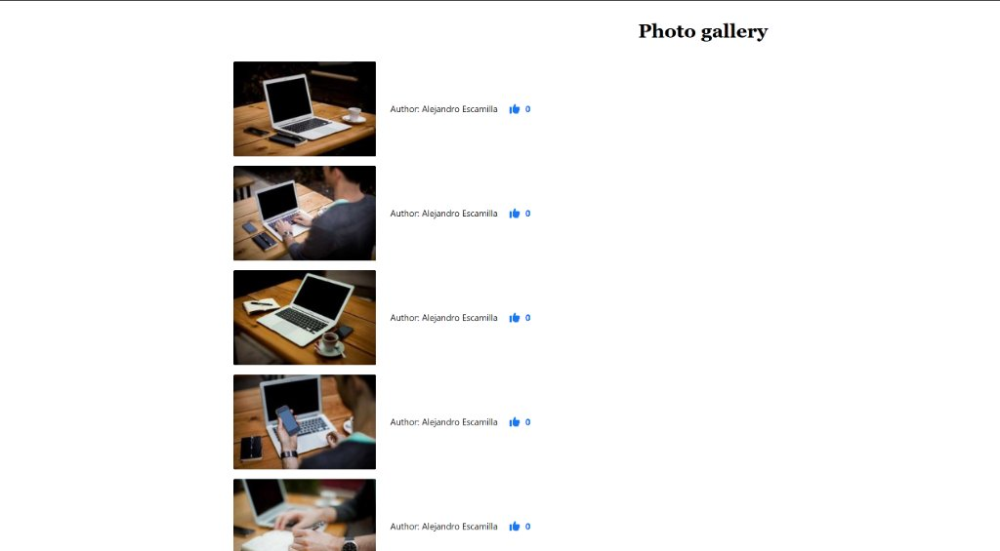
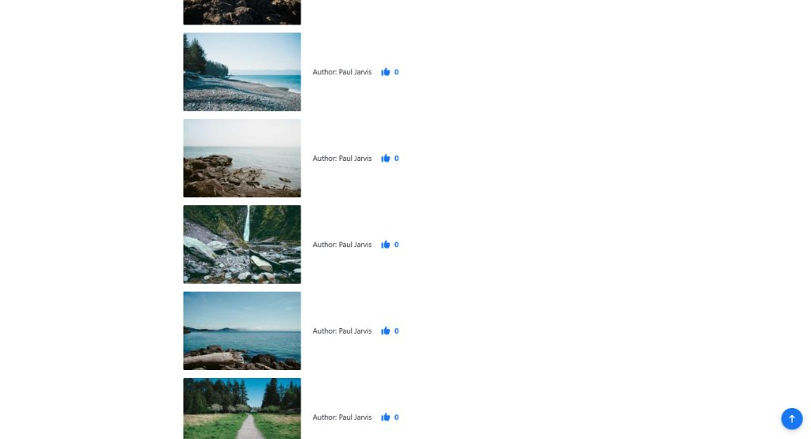
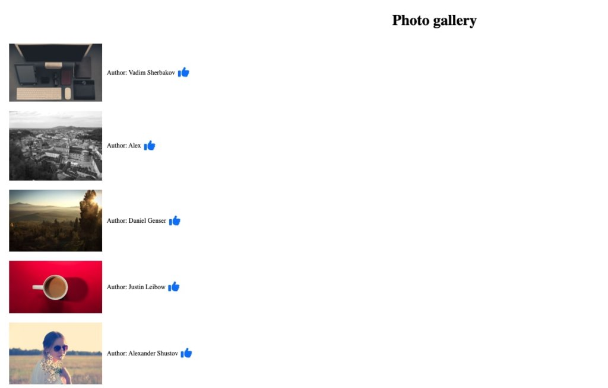

# Photo Gallery

A production-grade, single-page React photo gallery featuring infinite scrolling, paginated API ingestion, micro-animations, resilient error recovery, and enterprise security defenses. Built to exact design specifications matching the project reference with zero Cumulative Layout Shift (CLS) and 100% automated test coverage via Test-Driven Development (TDD).

---

## Visual Demonstration

| Initial Feed View | Infinite Scroll & Scroll-to-Top | Design Reference |
| :---: | :---: | :---: |
|  |  |  |
| *Initial page render matching 1-column layout* | *Subsequent pages appended with scroll-to-top button* | *Original reference design spec* |

---

## Design Alignment

The visual layout directly reflects the project reference specification:
- **Header**: Bold serif `"Photo gallery"` heading (`Georgia, serif`) positioned at the top of the single-column feed.
- **Photo Row Structure**:
  - **Left**: Fixed-dimension thumbnail container (`240px × 160px`, `3:2` aspect ratio) with smooth opacity fade-in transition on image load.
  - **Right**: Vertically centered metadata displaying `"Author: {author}"`, an inline FontAwesome thumbs-up icon (`#1877f2`), and an adjacent click counter.
- **Interactive Like Button**:
  - Initialized to `0`.
  - Increments by `+1` on each click without limit.
  - Triggers a CSS keyframe micro-bounce animation (`@keyframes thumbs-bounce`).
  - Maintains isolated state per photograph within React Context.

---

## Technical Highlights

### Core Feed & Infinite Scrolling
- **Paginated API Ingestion**: Fetches photographic data from the Picsum API (`https://picsum.photos/v2/list?page={page}&limit=10`).
- **IntersectionObserver Sentinel**: Utilizes a lightweight bottom sentinel element with a forward-looking `250px` root margin to trigger subsequent page fetches before the user reaches the absolute bottom.
- **Append-Only Feed**: Appends new items seamlessly to the active feed without re-rendering or wiping previously loaded entries.
- **Graceful Feed Termination**: Detects empty payload responses (`[]`) and unmounts the sentinel, rendering a status notification.

### UX & Performance Engineering
- **Zero Cumulative Layout Shift (CLS)**: Every image container reserves its dimensions upfront with strict CSS `aspect-ratio: 3 / 2` (`240px × 160px`), preventing layout jumping while images stream in.
- **Shimmer Skeleton Loaders**:
  - Initial load renders five placeholder rows with horizontal gradient shimmer keyframes.
  - Subsequent pagination loads render a single skeleton row below existing items while the next batch is in flight.
- **Reduced Motion Support**: Disables skeleton shimmer and like bounce animations when `@media (prefers-reduced-motion: reduce)` is detected.
- **Resilient Error Recovery**: When network or API requests fail, an accessible inline alert (`role="alert"`) provides a "Try Again" action that retries the exact failed page without clearing existing content.
- **Floating Scroll-To-Top**: A floating circular action button appears when the viewport scrolls beyond `400px`, invoking smooth scrolling to the top on click.

### Security Engineering
- **Zod v4 Schema Validation**: Validates all incoming API payloads through `PicsumPhotoListSchema` before data enters application state. Malformed fields or unexpected prototypes are caught and rejected safely.
- **Image Hostname Allowlisting**: Strictly validates that image URLs originate only from verified domains (`picsum.photos`, `fastly.picsum.photos`, `images.unsplash.com`, `unsplash.com`).
- **Anti-XSS Text Rendering**: Avoids `dangerouslySetInnerHTML` entirely. Untrusted author names containing script tags or HTML injection strings are rendered strictly as safe text nodes.
- **Prototype Pollution Defense**: Likes state management operates through immutable updates and guards against object prototype property injection (`__proto__`, `constructor`, `prototype`).
- **Request Deduplication**: In-flight reference guards (`inFlightRef`) prevent redundant duplicate requests when rapid scroll events occur.

---

## Test-Driven Development (TDD) Matrix

All features, data schemas, hooks, and UI components were developed following strict Red-Green-Refactor testing methodology using Vitest and React Testing Library.

| Suite | Component / Module | Scope | Test Count | Status |
| :--- | :--- | :--- | :---: | :---: |
| 1 | `schemas.test.js` | Zod schema validation & domain allowlisting | 23 | Passed |
| 2 | `galleryReducer.test.js` | Pure reducer state transitions & prototype defense | 9 | Passed |
| 3 | `Header.test.jsx` | Banner landmark & semantic heading structure | 2 | Passed |
| 4 | `ThumbsUpButton.test.jsx` | Micro-bounce animation, unlimited clicks, keyboard a11y | 6 | Passed |
| 5 | `PhotoRow.test.jsx` | 1-column layout, 3:2 ratio, fade-in, error fallback | 5 | Passed |
| 6 | `SkeletonRow.test.jsx` | Shimmer markup, accessibility status role | 1 | Passed |
| 7 | `fetchPhotos.test.js` | Network fetch, query parameters, Zod parsing | 6 | Passed |
| 8 | `usePicsumFeed.test.jsx` | Hook pagination, in-flight guard, error handling | 3 | Passed |
| 9 | `useInfiniteScroll.test.jsx`| IntersectionObserver sentinel hook & rootMargin | 3 | Passed |
| 10 | `ErrorState.test.jsx` | Alert role, error text display, retry callback | 3 | Passed |
| 11 | `ScrollToTop.test.jsx` | Visibility threshold (400px) & smooth scroll behavior | 4 | Passed |
| 12 | `GalleryFeed.test.jsx` | Feed orchestration, initial & pagination skeletons | 6 | Passed |
| 13 | `App.core.test.jsx` | End-to-end integration, anti-XSS, keyboard navigation | 6 | Passed |
| **Total** | **13 Test Suites** | **Comprehensive Full-Stack Coverage** | **77** | **100% Passed** |

*Code quality: `oxlint` reported **0 errors and 0 warnings** across all 34 source and test files.*

---

## Project Structure

```
photo-gallery/
├── client/
│   ├── src/
│   │   ├── components/
│   │   │   ├── ErrorState/          # Accessible error alert with retry button
│   │   │   ├── GalleryFeed/         # Infinite scroll feed container & sentinel
│   │   │   ├── Header/              # Serif "Photo gallery" title banner
│   │   │   ├── PhotoRow/            # 1-column photo row (240x160) + author + like
│   │   │   ├── ScrollToTop/         # Floating smooth scroll-to-top button
│   │   │   ├── SkeletonRow/         # Zero-CLS shimmer loading skeleton
│   │   │   └── ThumbsUpButton/      # Blue FontAwesome icon + bounce micro-animation
│   │   ├── constants/
│   │   │   └── gallery.js           # Layout dimensions, timeouts, texts, seed data
│   │   ├── context/
│   │   │   ├── GalleryContext.jsx   # Context provider for gallery state
│   │   │   ├── galleryContextDef.js # Fast Refresh clean context definition
│   │   │   ├── galleryReducer.js    # Immutable state management
│   │   │   └── useGallery.js        # Hook consumer
│   │   ├── hooks/
│   │   │   ├── useInfiniteScroll.js # IntersectionObserver sentinel hook
│   │   │   └── usePicsumFeed.js     # Paginated Picsum data hook with deduplication
│   │   ├── styles/
│   │   │   └── tokens.css           # Design tokens (colors, spacing, fonts, motion)
│   │   ├── utils/
│   │   │   └── fetchPhotos.js       # Validated API fetcher utility
│   │   ├── validation/
│   │   │   └── schemas.js           # Zod v4 schemas for API payloads & domain whitelist
│   │   ├── App.jsx                  # Main application orchestrator
│   │   ├── App.core.test.jsx        # E2E integration and security test suite
│   │   ├── main.jsx                 # Application entry point
│   │   └── setupTests.js            # Vitest + jsdom polyfills (IntersectionObserver)
│   ├── vercel.json                  # Production deployment configuration & CSP headers
│   ├── vitest.config.js             # Vitest test runner configuration
│   └── package.json
└── docs/                            # Specifications, checklists & reference assets
```

---

## Local Development & Setup

### Prerequisites
- Node.js v18 or higher
- npm v9 or higher

### Installation

```bash
# Navigate to the client directory
cd photo-gallery/client

# Install dependencies
npm install --legacy-peer-deps
```

### Running Locally

```bash
# Start the Vite development server
npm run dev
```

Open `http://localhost:5173` in your browser.

### Running Tests & Quality Checks

```bash
# Execute all 77 unit & integration tests
npm test

# Run code linter
npm run lint

# Build production bundle
npm run build
```

---

## Production Security Headers

The application includes enterprise security headers configured in `vercel.json`:
- `Content-Security-Policy`: Restricts script and connection sources, allowing only approved image domains (`picsum.photos`, `fastly.picsum.photos`, `unsplash.com`).
- `X-Frame-Options: DENY`: Prevents clickjacking attacks.
- `X-Content-Type-Options: nosniff`: Prevents MIME-type sniffing.
- `Referrer-Policy: strict-origin-when-cross-origin`: Minimizes referrer leakage.
- `Permissions-Policy: camera=(), microphone=(), geolocation=()`: Disables unused hardware access.
